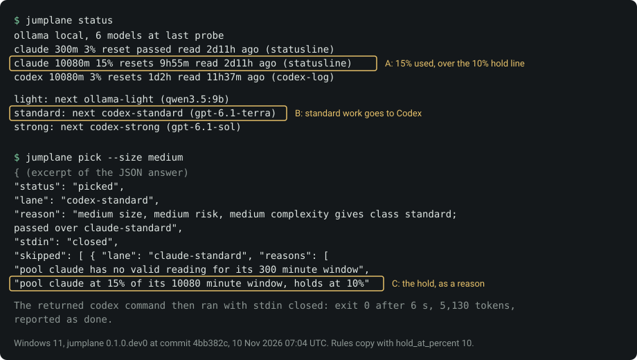
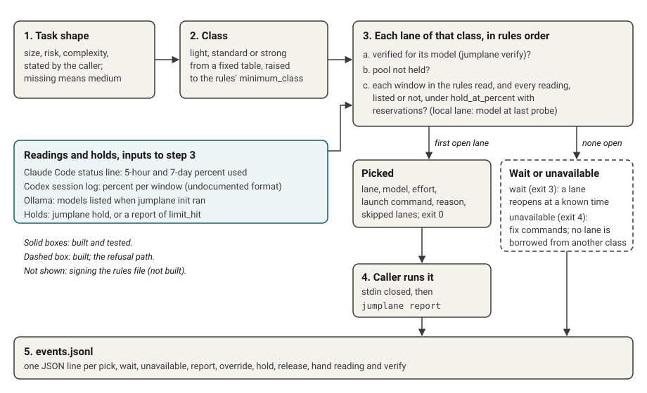

# jumplane

jumplane picks the tool, model, effort and launch command for a coding task from rules you accepted, and switches to another tool or model before a usage limit stops you.

 

Pre-release `v0.1.0`, for people who run Claude Code, Codex or Ollama from a terminal. MIT licence.

| Term | Meaning |
|---|---|
| lane | one tool, model and effort, such as Codex with `gpt-6.1-terra` at medium effort |
| pool | the usage limit that lanes share: a subscription's usage windows, or a local Ollama server |
| class | light, standard or strong; a task's size, risk and complexity give its class |
| hold line | the percent of a window used at which jumplane stops sending work to that pool; 90 by default |

*Figure 1. A recorded hold and move, 10 Nov 2026, commit 4bb382c, with the hold line set to 10% in a copy of the rules. Claude stood at 15% (A), so standard work went to Codex (B), and the pick gave the hold as its reason (C). Limits: one session on one Windows PC; JSON cut, one line wrapped.*

## Why

Coding agents on a subscription stop when a usage window fills, and the host does not move you to another one. Claude Code's [model configuration page](https://code.claude.com/docs/en/model-config) says rate-limit errors "never trigger a switch" to its fallback model.

jumplane is not a proxy and holds no keys. It reads the limit numbers your tools already expose, and returns a command for you or your agent to run.

## Features

- `jumplane status` shows each pool, percent used, reset time, age of the reading, holds, and the lane that runs next per class.
- `jumplane pick` maps size, risk and complexity to one of three classes with a fixed table, then returns the first open lane in your order.
- A pool at the hold line on any window with a valid reading is passed over, and the pick moves to the next lane in the same class.
- Every lane passed over is listed under `skipped` with its cause and the command that would open it. An unverified lane is passed over for the next lane in the same class; work never moves to another class.
- `jumplane report` records the outcome, tokens and a receipt path. Every decision is one line in a [plain event log](docs/events.md).
- No proxy, no API keys, no telemetry, no prompt reading. `pick` opens no socket: only `probe.py`, used by `init` and `verify`, may import network or process modules, which the test `test_only_probe_may_touch_the_network_or_processes` checks. The code uses the Python standard library only.
- Local models: any model a local Ollama server lists can be a lane. Five were launch-verified on one PC; [local lanes](docs/local-lanes.md) lists them with their sources.

*Figure 2. How a pick is made, as built in `src/jumplane/engine.py` at this commit. Rules and code choose the route; model output never does. The dashed box is the refusal path. Not shown: signing the rules file, which is planned and not built.*

Measured on one Windows 11 PC on 10 Nov 2026: 78 tests pass with `PYTHONPATH=src python -m unittest discover -s tests -t .`, and there are 0 runtime dependencies (`dependencies = []`, held by a test).

No benchmark has run, so jumplane makes no claim about quality or savings. [Status and limits](docs/limits.md) lists what is built, what is not, and what is unmeasured.

## Quick start

1. Install [uv](https://docs.astral.sh/uv/), then jumplane from its tag: `uv tool install git+https://github.com/sourav-patra/jumplane@v0.1.0`. Check: `jumplane --version` prints a version.
2. Run `jumplane init`. It finds Claude Code, Codex and a local Ollama server and prints proposed rules without writing them. Check: the answer says `"status": "proposed"`.
3. Read the rules, then run `jumplane init --accept`. Check: `"status": "accepted"`.
4. Verify each hosted lane once, for example `jumplane verify codex-standard`. This sends one short prompt and uses a little of that plan. Check: `"status": "verified"`.
5. Run `jumplane status`. Check: each class shows `next` and a lane, or a `fix:` command to run.
6. Run `jumplane pick --size small --risk low --complexity low`, launch the returned command with stdin closed, then `jumplane report <pick_id> done`. Check: `"status": "recorded"`.

Claude Code shows its limits only through its status line. `jumplane init` prints the one settings line to add; without it the Claude pool has no reading and stays unavailable.

## Docs

- [Guide](docs/guide.md): the full loop for a person or an agent, exit codes, `wait` and `unavailable`.
- [Install](docs/INSTALL.md): macOS, Linux and Windows, update and remove.
- [Status and limits](docs/limits.md): built, not built, measured and unmeasured.
- [Event log](docs/events.md): the audit record and its fields.
- [Local lanes](docs/local-lanes.md): Ollama, open-weight models and their sources.
- [Decisions](docs/DECISIONS.md) and [roadmap](docs/ROADMAP.md).
- [Contributing](CONTRIBUTING.md) and [security](SECURITY.md).
